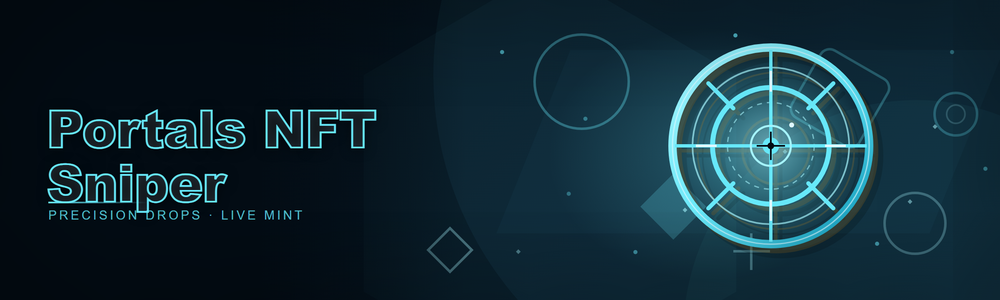
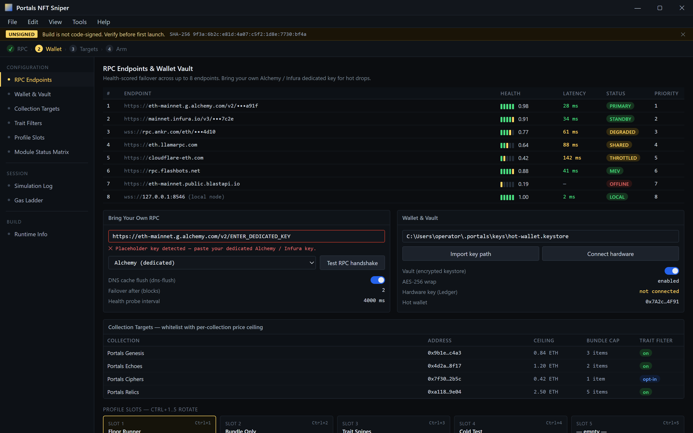
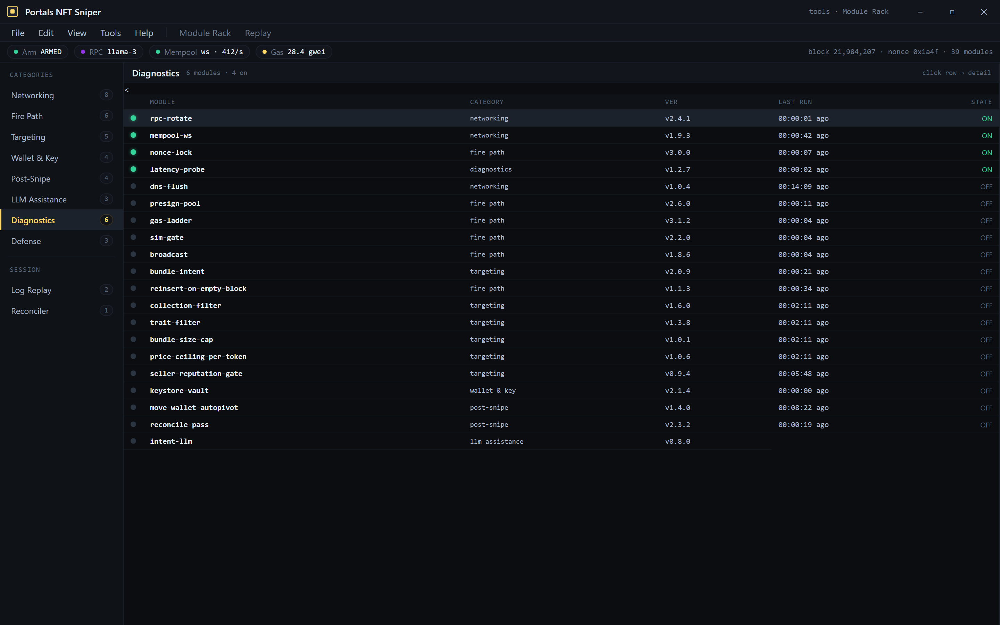

  
  
  

  

  
  

---

---

## 📋 System Requirements

Before you hit the download button, confirm your rig can actually push the sniper loop. Portals mints move in sub-second windows — an under-spec box means you miss the mint, not the config.

| Component   | Minimum                     | Recommended                     |
|-------------|-----------------------------|---------------------------------|
| OS          | Windows 10 64-bit (21H2)    | Windows 11 23H2+                |
| CPU         | Quad-core 2.4 GHz           | 6-core 3.6 GHz+                 |
| RAM         | 8 GB                        | 16 GB                           |
| Disk        | 250 MB free                 | 1 GB free (SSD)                 |
| Network     | 25 Mbps wired               | 100 Mbps+ wired, <40ms RPC RTT  |
| RPC Access  | Any Ethereum mainnet RPC    | Dedicated Alchemy/Infura key    |
| Runtime     | .NET Desktop Runtime 8      | Same + latest VC++ redistributable |

- 🖥️ **Wired connection non-negotiable** — Wi-Fi jitter is the #1 cause of missed Portals land.
- 🔑 **Bring your own RPC** — the default public endpoint works but is shared and throttled.
- 🧾 **No admin install required**, but admin context helps with DNS cache flushing between sessions.

---

## 🧭 Table of Contents

- [Overview](#overview)
- [The Problem](#the-problem)
- [The Solution](#the-solution)
- [What is Portals NFT Sniper](#what-is-portals-nft-sniper)
- [Get Started](#get-started)
- [Key Features](#key-features)
- [Hotkeys & Controls](#hotkeys--controls)
- [Apply Modules — Category Breakdown](#apply-modules--category-breakdown)
- [Usage guidelines](#usage-guidelines)
- [LLM-Assisted Intent Engine](#llm-assisted-intent-engine)
- [Known Issues](#known-issues)
- [Roadmap / Planned Features](#roadmap--planned-features)
- [FAQ](#faq)

---

## 🔭 Overview

2026 build. If you've seen the 2024 fork floating around on half-dead repos, this is not that. The engine has been rebuilt around an async pre-sign simulation loop, dependencies were cut from 41 to 9, and the whole thing compiles to a single portable `.exe` you extract and run. Cold start from double-click to RPC handshake averages under two seconds on SSD.

**Portals NFT Sniper** is a Windows-native mint sniper for the Portals marketplace. It watches the mempool, simulates the cheapest viable path to land a Portals NFT at floor, and fires a pre-signed transaction the millisecond a listing becomes frontable. It is not a bot farm, it is not a marketplace clone, and it does not abstract away what's actually happening on-chain — you configure intent, you review simulation output, the tool executes.

| Category          | Details                                                  |
|-------------------|----------------------------------------------------------|
| Product type      | Desktop mint sniper (.exe, Windows)                      |
| Primary target    | Portals marketplace listings + drops                     |
| Chain coverage    | Ethereum mainnet (L2 in roadmap)                         |
| Configuration     | Local JSON profiles + GUI-injected intent engine         |
| Distribution      | Portable `.exe` via project page → download              |
| Maintenance model | Small team, side project, release-when-ready cadence     |

---

## 🩹 The Problem

Anyone who has actually sniped Portals listings knows the pain points. This isn't marketing copy — it's a list of things that went wrong for us, repeatedly.

- **Listings die in ms, not seconds.** Manual clicking loses to indexer-fed bots by 400–900ms.
- **Gas estimation is a guess until it's too late.** Legacy snipers bundle a fixed gas value and either overpay 3x or fail the block.
- **RPC providers rate-limit during hot drops.** The one moment you need throughput is the one moment your endpoint drops you.
- **Portals bundles multi-item listings** — you have to pick the specific token vs. bid the whole bundle, and the wrong path wastes the shot.
- **Simulation is neglected.** Most snipers fire blind and hope. Reverted txs burn gas and lose the listing.
- **Signal noise across Discord/Telegram alpha groups** wastes 20+ minutes per useful target.
- **Forked 2024 builds are bloated.** Unmaintained dependencies, broken DRM fetches, no self-update path.

---

## 🛠️ The Solution

| Problem                                   | Solution in this build                                                       |
|-------------------------------------------|------------------------------------------------------------------------------|
| Manual clicking loses ms-level races      | Pre-signed hot wallet pool + async firing path on mempool hit                 |
| Fixed gas estimates overpay or revert     | Per-block gas ladder with adaptive tip based on prior 6 blocks                |
| RPC throttling during drops               | Multi-endpoint failover with health-scored rotation                          |
| Wrong venue on bundle listings            | Per-bundle intent analyzer picks token-target vs bundle-bid path             |
| Blind firing                             | Mandatory pre-fire simulation with decode + revert-reason surfacing          |
| Alpha noise                              | Local target list + filters (collection, price ceiling, trait whitelist)     |
| Bloated forks                            | 9-dependency .NET 8 native build, single `.exe`                              |

---

## 🔎 What is Portals NFT Sniper

Quick glossary for anyone arriving from a tweet that linked here without context.

| Term                | Explanation                                                                     |
|---------------------|---------------------------------------------------------------------------------|
| Portals             | The NFT marketplace this tool targets (listings, drops, bundles).              |
| Mint                | Acquiring an NFT directly at listing or drop, usually the secondary path here. |
| Bundle              | A Portals listing that bundles multiple tokens in one sale.                    |
| Pre-sign            | Signing a tx locally against a template, ready to broadcast on trigger.        |
| Simulation          | Eth_call replay of a tx to catch reverts / decode expected output.             |
| Snipe               | Winning the race for a listing by broadcasting first at acceptable gas.        |
| Floor               | The lowest active ask for a collection; the primary benchmark for sniping.     |

- The tool is a **sniper**, not a marketplace UI — it talks to the chain and posts txs.
- The chain of trust runs: **your wallet → your RPC → contract call**. No intermediary.
- The `+38 modules` referenced below are opt-in; the base sniper loop is functional on defaults.

---

## 🧨 Get Started

Four steps, no package manager, no repo clone.

1. 🔗 Visit the project page (linked in the release signature) and grab the latest `.exe` bundle.
2. 📦 Extract the archive to a folder you own (e.g. `C:\Tools\`), not into `Program Files`.
3. 🎛️ Launch the `.exe`. On first run it opens the config wizard — pick RPC endpoint, import wallet key path (or connect hardware), and set collection targets.
4. 🎯 Hit **Arm** and let it idle. The sniper watches, simulates, and fires only when a target matches your intent.

Your wallet → your RPC → contract. Nothing in between.

  

> If the Windows SmartScreen prompt fires on first launch, click "More info → Run anyway." Builds aren't code-signed (side project, signing certs are pricey), so this is expected behavior — verify the SHA-256 hash on the project page before running.

---

## 🎯 Key Features

Feature matrix across the 39 modules. Each row is a distinct feature; "Benefit" is what it changes about a snipe run.

| Feature                        | Description                                                                  | Benefit                                                         |
|--------------------------------|------------------------------------------------------------------------------|-----------------------------------------------------------------|
| Async pre-sign pool            | N pre-signed txs ready per target, rotated per block                         | Sub-200ms local latency on fire                                 |
| Gas ladder                     | Per-block tip ladder derived from prior 6 blocks                             | Lands in 1–2 blocks without overpay                             |
| Simulation gate                | Hard requirement to pass eth_call before broadcast                            | Kills most reverts before they burn gas                         |
| Bundle intent analyzer         | Decides token-target vs full-bundle bid per listing                          | Recovers snipes that manual bots miss on multi-item drops       |
| Multi-RPC failover             | Health-scored rotation across endpoints                                      | Snipe survives a provider throttling event                      |
| Vault (encrypted keystore)     | AES-wrapped local storage with optional hardware key                         | Keys stay local; no plain-text on disk                          |
| Target filters                 | Collection, price ceiling, trait whitelist, bundle-size limits               | Cuts noise; sniper never fires on scalps you don't want         |
| Post-snipe reconciler          | Matches local intents against on-chain events                                | Clear picture of success vs partial fills                       |
| Move-wallet autopivot          | Post-win transfer into cold address                                          | Lower exposure on the hot wallet                                |
| Log replay                     | Re-run prior block state against current module set                          | Test changes without risking live gas                           |

---

## 🧿 Hotkeys & Controls

Global hotkeys work anywhere in Windows; in-app hotkeys only when the sniper window has focus.

| Key                 | Action                                    | Notes                                                         |
|---------------------|-------------------------------------------|---------------------------------------------------------------|
| `Ctrl+Shift+A`      | Arm / disarm                              | Global; disarm closes the fire path within the current tick    |
| `F9`                | Panic stop + zero pre-signed pool         | Halts broadcast pending, purges pool                           |
| `F5`                | Re-simulate current targets               | Useful after gas-ladder recalc                                 |
| `F6`                | Snapshot current config to profile slot   | 5 named slots; rotate with `Ctrl+1..5`                         |
| `Ctrl+R`            | Force RPC rotation                        | For when a provider is behaving badly                          |
| `Alt+1..9`          | Quick-arm to target slot                  | Per-slot intents (collection+ceiling)                          |
| `Ctrl+L`            | Open log viewer                           | Tails `snipe.log` with filter bar                              |
| `Esc`               | Close modal / abort confirm               | Does **not** disarm                                             |

---

## ⚙️ Apply Modules — Category Breakdown

39 modules split into 8 domain categories. Some are default-on (fire path), others opt-in (post-mortem, defense). Each category opens with a short prose paragraph describing what it actually does, followed by bullets on the specific modules — this avoids the "here's another table repeating the features table" trap.

39 modules. 8 categories. Default-on fire path, opt-in everything else.

### 🕸️ Networking Modules

The networking layer is the difference between winning and watching. Health-scored rotation means a throttled Alchemy endpoint doesn't kill your shot, and DNS cache flushing at session start trims the handshake overhead across all endpoints.

- **`rpc-rotate`** — health-scored rotation across up to 8 RPC endpoints.
- **`mempool-ws`** — WebSocket subscription to `newPendingTransactions` with backpressure handling.
- **`nonce-lock`** — reserves nonces atomically so rotation never double-uses a slot.
- **`latency-probe`** — per-endpoint latency windows; downgrades stale or lagging endpoints automatically.
- **`dns-flush`** — forces resolver refresh at fire time to avoid stale lookups on drops.

### 💳 Fire Path Modules

This is the sniper core. Modules here are default-on. You configure intent, e

[…truncated for layout…]